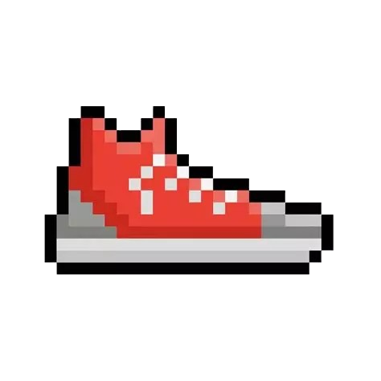

# Touch Me Reforged

[](https://github.com/JPDeerenberg/Touch-Me/actions/workflows/build.yml)
[](https://github.com/JPDeerenberg/Touch-Me/releases/latest)
[](LICENSE)

A fast-paced **local multiplayer game of tag**. One player is *IT* — touch someone
else before the timer runs out, or you lose. Built with Rust and
[macroquad](https://github.com/not-fl3/macroquad).



## Download

Grab the newest build from the [releases page](https://github.com/JPDeerenberg/Touch-Me/releases/latest):

| Platform | Direct download |
| --- | --- |
| Linux (x86_64) | [touch-me-linux-x86_64.tar.gz](https://github.com/JPDeerenberg/Touch-Me/releases/latest/download/touch-me-linux-x86_64.tar.gz) |
| Windows (x86_64) | [touch-me-windows-x86_64.zip](https://github.com/JPDeerenberg/Touch-Me/releases/latest/download/touch-me-windows-x86_64.zip) |
| macOS (Apple Silicon) | [touch-me-macos-arm64.tar.gz](https://github.com/JPDeerenberg/Touch-Me/releases/latest/download/touch-me-macos-arm64.tar.gz) |
| macOS (Intel) | [touch-me-macos-x86_64.tar.gz](https://github.com/JPDeerenberg/Touch-Me/releases/latest/download/touch-me-macos-x86_64.tar.gz) |

Every push also produces the same binaries as workflow artifacts on the
[Actions tab](https://github.com/JPDeerenberg/Touch-Me/actions/workflows/build.yml).

The binaries are **self-contained**: all sprites are compiled into the executable,
so you can unpack them anywhere and just run `touch_me` (`.exe` on Windows).

On macOS the `.app` is only ad-hoc signed, so the first launch requires
*right-click → Open* (or `xattr -dr com.apple.quarantine "Touch Me Reforged.app"`).

## Controls

| Player | Keys |
| --- | --- |
| P1 | `W` `A` `D` |
| P2 | `↑` `←` `→` |
| P3 | `I` `J` `L` |
| P4 | `T` `F` `H` |

`Esc` pauses the game.

## Features

- 2–4 players on one keyboard, 5 built-in maps (Forest, Desert, Cyber, Ocean, Ice)
- Powerups: turbo sneakers, double jump cloud, ghost (untaggable), ice patch,
  shield, and linked portals
- Configurable match timer
- In-game level editor: draw platforms, add jump pads, place spawn points and
  export levels to JSON

Custom levels are stored in the platform user-data folder:

- Linux: `~/.local/share/touch_me/custom_levels` (`$XDG_DATA_HOME` is honoured)
- Windows: `%APPDATA%\touch_me\custom_levels`
- macOS: `~/Library/Application Support/touch_me/custom_levels`

Set `TOUCH_ME_LEVELS_DIR` to override that location (handy for a portable install).
Sprites can be overridden by dropping a file with the same relative path
(`players/red.png`, `images/shield.png`, ...) next to the executable.

## Build from source

```bash
cargo run --release
```

Installers/packages can also be built locally with
[`cargo-packager`](https://github.com/crabnebula-dev/cargo-packager) or
[`cargo-deb`](https://github.com/kornelski/cargo-deb); `./build_all.sh` does the
whole dance for you.

## CI

`.github/workflows/build.yml` builds a release binary for Linux, Windows and macOS
(both architectures), bundles each one and uploads it as a workflow artifact.
Pushing a tag such as `v0.1.0` additionally publishes a GitHub release with all
artifacts attached.

## License

MIT — see [LICENSE](LICENSE).
